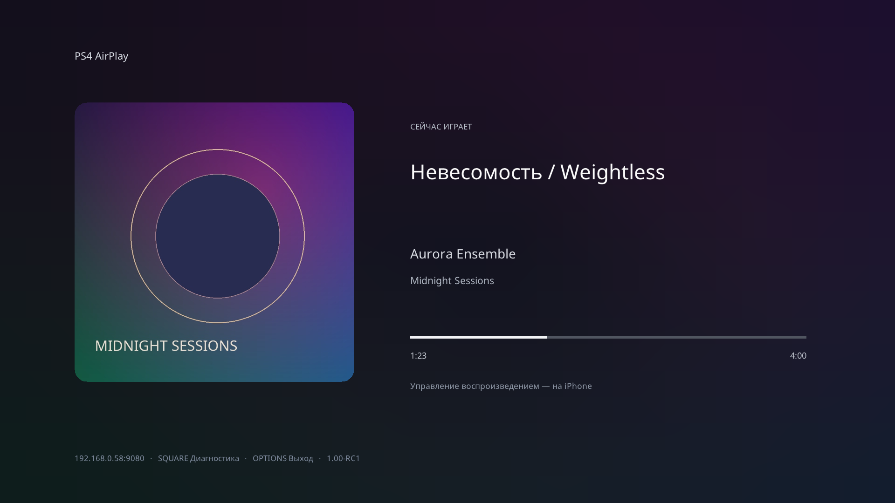

# PS4 AirPlay

Самостоятельный AirPlay-приёмник для PS4 с HEN: музыка, повтор экрана и прямое
видео из плеера iPhone. Для воспроизведения компьютер не нужен.

**Текущая версия: 1.00-RC1, на базе 0.13.** Музыка и повтор экрана базовой версии
проверены пользователем на PS4 13.52. Новый системный видеоплеер и экран музыки
RC1 пока требуют проверки на консоли. Работа всех приложений iOS не заявляется.



## Установка

1. Скачайте **PS4-AirPlay-1.00-RC1.pkg** из раздела **Releases**.
2. При включённом HEN установите PKG и откройте приложение. При обновлении оно
   использует прежний TITLE_ID `ARPL00001`.
3. Подключите iPhone и PS4 к одной локальной сети. Дождитесь готовности приложения
   и выберите **PS4 AirPlay** в меню AirPlay на iPhone.

## Воспроизведение

- **Apple Music:** звук, обложка, название, исполнитель, альбом и прогресс,
  если iPhone передаёт эти данные.
- **Повтор экрана:** отдельный режим из Пункта управления iPhone; тракт из 0.13.
- **Видео из плеера:** кнопка AirPlay в самом видеоплеере Safari. Прямые HTTP(S)
  ссылки MP4/HLS обрабатывает системный AvPlayer PS4; реализованы пауза и перемотка.
- **YouTube:** реализован обратный FCUP-канал и локальная выдача HLS-плейлистов.
  Совместимость с текущим iOS-приложением YouTube ещё не подтверждена на PS4.

**DRM-видео не поддерживается.** Доступность URL, HTTPS и кодеков зависит от
источника и системного плеера консоли.

## Управление и диагностика

`SQUARE` — технический экран; `CROSS` — пауза прямого видео;
`CIRCLE` — остановка видео; `OPTIONS` — штатный выход.
Музыкой и повтором экрана управляет iPhone.

Отчёт: Safari → `http://IP-PS4:9080/` → **Скачать отчёт**. IP показан на экране.
При зависании скачайте отчёт до перезапуска. При краше откройте приложение снова
и сначала сохраните отчёт. Не публикуйте личные отчёты без проверки содержимого.

Настройка качества в диагностике относится к повтору экрана и применяется после
перезапуска. Для прямого видео качество определяется ссылкой/плейлистом.

## Сборка

Код приложения находится в `source/`, патченное ядро UxPlay — в
`work/airplay-port/vendor/uxplay-lib/`. Закреплённые исходники сторонних библиотек
и готовые PS4 static libraries доступны в полном `*-source.zip` в Releases.

```sh
python3 scripts/bootstrap_dependencies.py
export OO_PS4_TOOLCHAIN=/absolute/path/OpenOrbis/PS4Toolchain
export PS4_CLANG=/absolute/path/clang
export PS4_LLD=/absolute/path/ld.lld
export PS4_FSELF=/absolute/path/create-fself
export PS4_PKGTOOL=/absolute/path/pkgtool-wrapper
export PS4_AIRPLAY_PORT="$PWD/work/airplay-port"
python3 source/scripts/build_core.py
python3 source/scripts/build.py
```

Bootstrap проверяет SHA256 архива и извлекает только зависимости, не заменяя
код приложения и отслеживаемое ядро. Можно использовать локальный файл:
`python3 scripts/bootstrap_dependencies.py --archive /path/to/PS4-AirPlay-1.00-RC1-source.zip`.

Подробнее: [сборка на Apple Silicon](source/docs/BUILD-APPLE-SILICON.md),
[зависимости и лицензии](source/docs/DEPENDENCIES.md),
[описание RC1](source/README.md).

## Проверки

- ASan/UBSan: DMAP/UTF-8, JPEG/PNG-обложки, прогресс, отрисовка и кэш.
- Mock системного плеера: ABI, память, NV12/PCM, URL, стартовая позиция,
  пауза/продолжение, перемотка, остановка и ошибка источника.
- Настоящее UxPlay-ядро: HTTP `/play`, управление, reverse upgrade, полный
  FCUP-обмен master/media, переписывание URL и выдача HLS-плейлистов.
- Регрессии H.264, HTTP, HEN, recovery, профилей и native Orbis I/O mock.
- Сборка ядра и приложения из распакованного source ZIP, 28 PKG-проверок,
  извлечение и сравнение runtime-модулей.

Эти проверки не заменяют проверку новой RC1 на PS4.

Для host-тестов: `source/scripts/build_video_ffmpeg.py --host --fast`,
`source/scripts/test_release.sh` и `source/scripts/test_airplay_protocol.py`.
Для последнего требуются make и OpenSSL (путь задаётся через `HOST_OPENSSL`).

## Лицензия

GPL-3.0-or-later; сторонние компоненты сохраняют свои лицензии.
См. [LICENSE](LICENSE), `source/third_party/`, `source/assets/fonts/OFL.txt` и
`source/docs/DEPENDENCIES.md`. Проприетарные модули Sony не распространяются.
Проект не связан с Apple или Sony.
